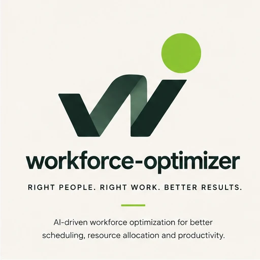
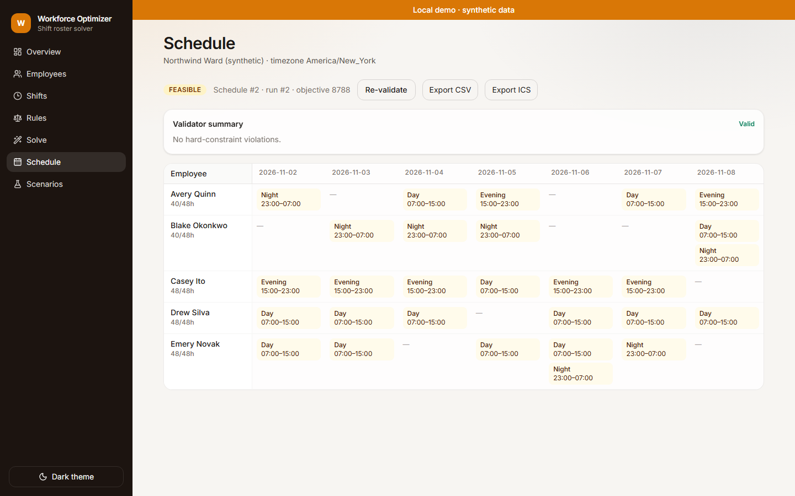
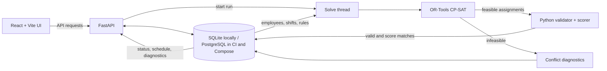

# Workforce Optimizer

**A constraint-based roster, with the result checked independently.**

Build shift schedules with OR-Tools CP-SAT, inspect solver status and trade-offs, and re-check assignments with a separate Python validator. A local demo using synthetic ward data.

The interesting boundary is what happens after a solve: a feasible assignment is checked again against the configured rules, and its weighted score is reconciled before a schedule is stored. A valid roster is not necessarily optimal or legally compliant. The project also makes infeasibility visible without claiming to identify a minimal cause.

[](https://github.com/hasanhuseyinyetkiner/workforce-optimizer/actions/workflows/ci.yml)
[](LICENSE)

[Architecture](#architecture) · [Solver and validation](#solver-and-validation) · [Quick start](#quick-start) · [Evidence](#evidence) · [Documentation](#documentation)



<sub>Real application capture: a feasible Northwind Ward schedule, with validation and export controls. Data is synthetic.</sub>

[Watch the real scenario → solve → schedule validation workflow (GIF)](docs/assets/demo.gif). The screenshot above is a static alternative; regenerate the animation on Windows with `node scripts/generate-demo-gif.mjs` after installing the project dependencies, Playwright Chromium and FFmpeg. The isolated synthetic data and recording are retained in a temporary folder.

## Architecture



The API starts a background solve thread. It builds a problem from stored data; after a feasible solve, the validator checks the assignment and the scorer reconciles its objective before the schedule is saved. Validation and export paths also re-check stored assignments. See the [algorithm notes](docs/ALGORITHM.md) for model details.

## Solver and validation

The model uses employee-by-shift Boolean variables, pruning ineligible assignments before solving. Hard rules constrain the roster; soft penalties account for cost, preferences, overtime, fairness, night and weekend balance. Coverage or skill shortfalls are allowed only when the explicit `relaxed_understaffing` rule is enabled and penalized in the objective.

| Solver status | What it means |
| --- | --- |
| `OPTIMAL` | An optimal solution was proven. |
| `FEASIBLE` | An assignment was found, but optimality was not proven. |
| `INFEASIBLE` | No assignment satisfies the configured model rules; no schedule is stored. |
| `UNKNOWN` | No usable proof or assignment, including timeout or a rejected model; no schedule is fabricated. |

The validator checks hard rules without OR-Tools; it **does not prove optimality**. It shares eligibility helpers with the solver, so a defect in those helpers could affect both checks. Infeasibility concerns the configured model, not a legal judgment. Diagnostics use best-effort group-level sufficient assumptions and relaxation probes; they do not establish a minimal infeasible subsystem over individual constraints. [Details and reproducibility limits →](docs/ALGORITHM.md)

## Quick start

Prerequisites: **Python 3.12+**, [uv](https://docs.astral.sh/uv/), **Node.js 24** and **pnpm 12.14.0** (the versions used in CI). Run from the repository root in two terminals:

```powershell
# Terminal 1: API at http://127.0.0.1:8103
cd backend
uv sync
uv run python -m app.cli
```

```powershell
# Terminal 2: UI at http://127.0.0.1:5103
cd frontend
pnpm install --frozen-lockfile
pnpm dev
```

Open [127.0.0.1:5103](http://127.0.0.1:5103), select **Scenarios**, and run **OPTIMAL** or **FEASIBLE**. Inspect the resulting schedule and validator summary, then try **INFEASIBLE** to see conflict diagnostics. Scenario labels describe expected outcomes; the displayed solver status is the actual result.

Native development defaults to SQLite and seeds synthetic data. Optional settings are documented in [`.env.example`](.env.example); the API binds to loopback by default. Interactive API documentation is available at [127.0.0.1:8103/docs](http://127.0.0.1:8103/docs) while the backend is running.

## Evidence

The [CI workflow](.github/workflows/ci.yml) defines local Markdown link checks, backend lint and tests with PostgreSQL, frontend checks, Playwright journeys and a Compose smoke job. Run the core checks locally:

```powershell
cd backend
uv run ruff check .
uv run pytest -q
uv run python scripts/micro_benchmark.py

cd ../frontend
pnpm lint
pnpm typecheck
pnpm test
pnpm build
pnpm test:e2e
```

Playwright requires Chromium (`pnpm exec playwright install chromium`) and starts or reuses the local services as configured. The screenshot capture test writes to `docs/screenshots/`.

The [2026-10-21 performance baseline](docs/PERFORMANCE_BASELINE.md) records one local instance ladder, including a **FEASIBLE** demo with objective 8788 and bound 8613, plus a separate reproducibility check. It is a portfolio micro-benchmark, not a production-scale performance claim. The [earlier benchmark](docs/BENCHMARK.md) is historical.

The [INRC-I assessment](docs/INRC_ASSESSMENT.md) traces the official instances and evaluator, identifies unresolved data licensing, and explains why this model's constraints, objective and run conditions cannot be compared with competition results. No real-data or INRC performance result is claimed.

## Security & limitations

This is a **trusted-local demo**, not a production HR system: there is no authentication or multi-tenancy, and real employee or medical data should not be loaded. The API defaults to loopback; a non-loopback bind requires `ALLOW_NETWORK_BIND=true`. CORS is not authentication. The solver worker count is capped at four.

Configured constraints do not establish labor-law or collective-bargaining compliance. Reproducible mode depends on the solver version and parameters; wall-clock runtime varies. Local Docker/Compose smoke testing was previously blocked by host availability; the CI job exists, but its presence alone does not establish that it passed. See [security boundaries](SECURITY.md).

## Documentation

- [Algorithm, status semantics and diagnostics](docs/ALGORITHM.md)
- [Measured performance baseline](docs/PERFORMANCE_BASELINE.md) · [Historical benchmark](docs/BENCHMARK.md)
- [INRC-I source and comparability assessment](docs/INRC_ASSESSMENT.md)
- [Frontend development and screenshot procedure](frontend/README.md)
- [Security](SECURITY.md) · [Configuration](.env.example) · [MIT license](LICENSE)
- [Changelog](CHANGELOG.md)
