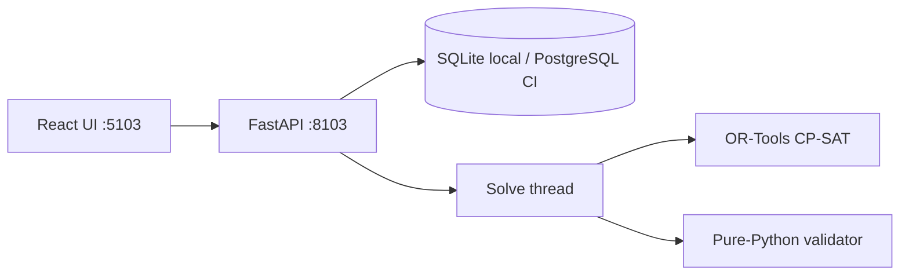

<p align="center">
  
</p>

# Workforce Optimizer

Local CP-SAT roster demo: assign staff to shifts under hard coverage / skill / rest / hour rules, return honest solver status, and re-check assignments with an OR-Tools-free validator.

Accent: **`#D97706`**. Ports: API **8103**, web **5103**. License: [MIT](LICENSE).

[](https://github.com/hasanhuseyinyetkiner/workforce-optimizer/actions/workflows/ci.yml)

<p align="center">
  
</p>

## For HR and talent leaders

| Question | What this tool gives you |
| --- | --- |
| **Does a valid roster exist?** | The solver reports OPTIMAL, FEASIBLE or INFEASIBLE honestly and never invents assignments. |
| **Can I check the result independently?** | A separate validator re-checks every assignment against the hard rules. |
| **Why did the roster change?** | Objective components and conflict diagnostics explain trade-offs and clashing rule groups. |
| **What it is not** | A model result, not a labor-law verdict. Synthetic Northwind Ward data only. |

## Why it exists

Ward managers need a roster that respects configured constraints — and a clear `INFEASIBLE` when nothing works. This app never fabricates assignments on conflict. Status is a model result, not a labor-law verdict.

## Capabilities

| Shipped | Notes |
| --- | --- |
| OR-Tools CP-SAT model | Hard vs soft terms; reproducible / fast modes |
| Independent validator | Pure Python; used on validate + export |
| Scenarios | Toggle **OPTIMAL / FEASIBLE / INFEASIBLE** with live wall-ms telemetry |
| Conflict diagnostics | Structural findings + assumption-group unsat core (**not** a proven minimal IIS) + relaxation probes |
| Dense roster grid | Employee×day CSS grid, violation badges, CSV/ICS export |
| Solver telemetry | Wall ms, objective, best bound, gap, component breakdown |

Synthetic Northwind Ward data only. Local demo / MVP — not multi-tenant SaaS.

## Current status

| Area | Status |
| --- | --- |
| CP-SAT + independent validator | Intact; hard violations never stored as successful schedules |
| Conflict diagnostics | Assumption-group / unsat core wording; no minimal-IIS claim |
| Objective explainability | Independent `score_schedule` breakdown must match solver total (golden tests) |
| Performance | Re-measured 2026-10-21 → [PERFORMANCE_BASELINE.md](docs/PERFORMANCE_BASELINE.md) |
| Playwright e2e | CI job kept; a11y smoke + INFEASIBLE journey added |
| Docker / compose | **Blocked** in this workspace — `compose-smoke` job may fail until Docker is available |
| Screenshots in README | From a prior captured Playwright session under `docs/screenshots/` (not regenerated this session unless noted) |

## Architecture



Model: [docs/ALGORITHM.md](docs/ALGORITHM.md) · this-session baseline: [docs/PERFORMANCE_BASELINE.md](docs/PERFORMANCE_BASELINE.md) · historical: [docs/BENCHMARK.md](docs/BENCHMARK.md).

## Quick start

```powershell
# Backend — http://127.0.0.1:8103
cd backend
uv sync
uv run python -m app.cli

# Frontend — http://127.0.0.1:5103 (new terminal)
cd frontend
pnpm install
pnpm dev
```

Env: [`.env.example`](.env.example). Non-loopback bind needs `ALLOW_NETWORK_BIND=true`.

### 60-second path

1. Open http://127.0.0.1:5103
2. **Scenarios** → **OPTIMAL** (or **FEASIBLE**) — load + solve, watch wall ms
3. **Schedule** → dense grid + validator summary
4. **INFEASIBLE** toggle → Solve shows conflict groups (e.g. skill requirements), no roster

### API sketch

```powershell
curl -X POST http://127.0.0.1:8103/api/demo/load -H "Content-Type: application/json" -d "{\"scenario\":\"optimal\"}"
curl -X POST http://127.0.0.1:8103/api/optimization-runs -H "Content-Type: application/json" -d "{\"mode\":\"reproducible\",\"random_seed\":1}"
```

Scenarios: `optimal` | `feasible` | `infeasible`.

## Status semantics

| Status | Meaning |
| --- | --- |
| `OPTIMAL` | Proven optimum within the search budget |
| `FEASIBLE` | Feasible assignment; not proven optimal (gap may be &gt; 0) |
| `INFEASIBLE` | No assignment under configured hard rules — **no schedule row** |
| `UNKNOWN` | Timeout / unexpected / model invalid — **no fabricated roster** |

## Diagnostics (honest)

On `INFEASIBLE`: structural findings, CP-SAT **constraint-group** assumptions (`sufficient_assumptions_for_infeasibility` + deletion filter), and progressive relaxations. This is **not** a proven minimal IIS over every individual constraint. See [ALGORITHM.md](docs/ALGORITHM.md#diagnostics-best-effort).

## Tests & benchmark

```powershell
cd backend
uv run ruff check app tests
uv run pytest -q
uv run python scripts/micro_benchmark.py

cd ../frontend
pnpm lint && pnpm typecheck && pnpm test && pnpm build
pnpm test:e2e
```

This-session measured baseline: [docs/PERFORMANCE_BASELINE.md](docs/PERFORMANCE_BASELINE.md). Historical ladder: [docs/BENCHMARK.md](docs/BENCHMARK.md).

## Docs

| Doc | Contents |
| --- | --- |
| [ALGORITHM.md](docs/ALGORITHM.md) | Variables, hard/soft, diagnostics, status |
| [PERFORMANCE_BASELINE.md](docs/PERFORMANCE_BASELINE.md) | Measured 2026-10-21 size ladder |
| [BENCHMARK.md](docs/BENCHMARK.md) | Historical measured ladder (2026-10-20) |
| [SECURITY.md](SECURITY.md) | Loopback demo boundaries / non-goals |
| [frontend/README.md](frontend/README.md) | SPA notes |

## Limitations

- Not labor-law compliance. `INFEASIBLE` ≠ “legally prohibited.”
- Demo auth: none. Loopback by default. CP-SAT workers capped at 4.
- Assumption-group cores are best-effort, not full IIS.
- Docker local smoke is blocked until Docker is usable on the host.
