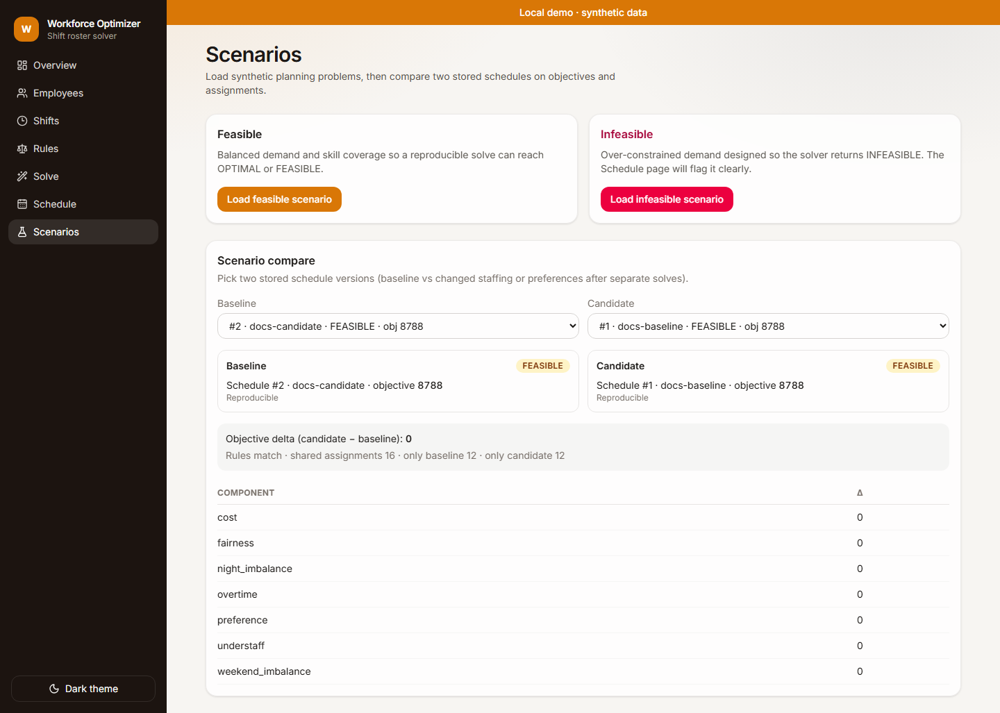
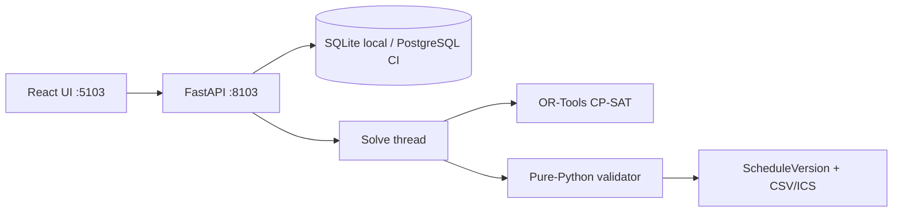
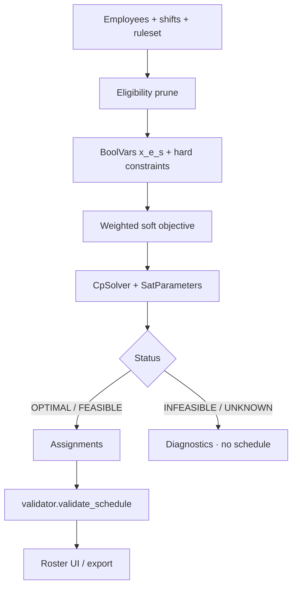

<a id="readme-top"></a>

<div align="center">

<picture>
  <source media="(prefers-color-scheme: dark)" srcset="docs/assets/banner-dark.svg">
  
</picture>

# Workforce Optimizer

**Constraint-based scheduling that explains every shift assignment.**

Roster tools often hide the model — or invent a schedule when constraints conflict. This app builds an OR-Tools **CP-SAT** assignment model, returns honest solver status (`OPTIMAL` / `FEASIBLE` / `INFEASIBLE` / `UNKNOWN`), and rechecks every hard rule with a pure-Python validator that never imports the solver.

[](https://github.com/hasanhuseyinyetkiner/workforce-optimizer/actions/workflows/ci.yml)

[Overview](#executive-overview) · [Demo](#product-demonstration) · [Math model](#engineering-deep-dive) · [Evidence](#evaluation-and-evidence) · [Quick start](#getting-started) · [Docs](#documentation)

</div>

<p align="center">
  
</p>

---

## Executive overview

| Dimension | Description |
| --- | --- |
| Business challenge | Ward managers need a roster that respects configured coverage, skills, rest, PTO, and hour caps — and a clear answer when no such roster exists. |
| Proposed solution | Local web app: configure employees / shifts / rules → run CP-SAT → inspect status + objective breakdown → re-validate → export CSV/ICS. |
| Primary users | Operations / workforce planners evaluating constraint-based scheduling; engineers reviewing OR modeling. |
| Engineering challenge | Correct overnight / DST time handling, reproducible CP-SAT parameters, independent validation, no fabricated assignments on infeasibility. |
| Architecture | React + Vite (:5103) → FastAPI (:8103) → SQLite local / PostgreSQL CI → OR-Tools CP-SAT in a worker thread → pure-Python validator. |
| Validation | pytest (tiny optimum enumeration, reproducible×10, infeasible demo), Playwright demo→solve→validate→export, measured micro-benchmark ([docs/BENCHMARK.md](docs/BENCHMARK.md)). |
| Project status | **Local demo / MVP** with synthetic Northwind Ward data. Not a multi-tenant SaaS. Not labor-law compliance — `INFEASIBLE` means configured hard rules conflict, not “legally prohibited.” |

Brand accent: **`#D97706` (amber)** — matches the shipped UI, banners, and screenshots (preferred emerald `#059669` deferred to avoid a split brand).

---

## Product demonstration

Authentic captures from a live local run (`http://127.0.0.1:5103` + API `:8103`, Playwright `e2e/screenshots.spec.ts`, 2026-10-20).

| Step | What you see |
| --- | --- |
| 1. Overview | Counts, latest `FEASIBLE` run, objective breakdown, **Valid** validator card |
| 2. Solve | Reproducible mode, seed, **Run reproducible solve** |
| 3. Schedule | Custom employee×day roster grid (CSS grid; not a third-party calendar widget) |
| 4. Validate | Re-validate → **No hard-constraint violations** |
| 5. Scenarios | Load feasible / infeasible demos; compare two stored schedules |

<p align="center">
  
</p>

<p align="center">
  
</p>

<p align="center">
  
</p>

<p align="center">
  
</p>

### 60-second UI path

1. Open http://127.0.0.1:5103 — banner **Local demo · synthetic data**.
2. **Solve** → **Run reproducible solve** (seed shown in the form).
3. Expect `FEASIBLE` or `OPTIMAL` → **Schedule** → **Validator summary: Valid**.
4. **Overview** → objective breakdown (cost / preference / fairness / …).
5. Optional: **Scenarios** → load **infeasible** → solve again → `INFEASIBLE`, no roster cells to export.

### API path (measured live on `:8103`)

```powershell
curl -X POST http://127.0.0.1:8103/api/demo/load -H "Content-Type: application/json" -d "{\"scenario\":\"feasible\"}"
curl -X POST http://127.0.0.1:8103/api/optimization-runs -H "Content-Type: application/json" -d "{\"mode\":\"reproducible\",\"random_seed\":42}"
# poll GET /api/optimization-runs/{id} until SUCCEEDED
curl -X POST http://127.0.0.1:8103/api/schedules/1/validate
```

Measured (reproducible demo): `solver_status=FEASIBLE`, `objective=8788`, validate → `{"valid":true,"violations":[]}`, 28 assignments. Infeasible scenario: `INFEASIBLE`, `schedule_id=null`, diagnostics include `no_qualified_employee` — no fabricated roster.

---

## Problem and engineering approach

**Problem.** Staffing is a constrained combinatorial assignment: coverage and skills are hard; cost, preference, and fairness are soft. Heuristic calendars either violate rest/PTO silently or “fill” gaps when the problem is actually unsatisfiable.

**Why not a spreadsheet / greedy fill?** Overnight shifts, ISO-week caps with prior boundary hours, skill `any_of` groups, and consecutive-day windows interact. Hand-built rosters do not prove feasibility; soft-score trade-offs need an explicit objective.

**Approach.** Decision variables are employee×shift booleans. Hard constraints are CP-SAT linear constraints (and eligibility pruning before variables exist). Soft terms enter a weighted minimize. Solver status is persisted verbatim. A second, OR-Tools-free validator re-derives hard violations from the assignment list for API validate/export.

**Deliberately out of scope.** Labor-law certification or compliance claims, multi-user auth, drag-edit premium timeline widgets, automatic employment decisions, claiming `OPTIMAL` when the search budget only reached `FEASIBLE`.

---

## System architecture





| Path | Role |
| --- | --- |
| `backend/app/domain/` | Problem DTOs, eligibility, CP-SAT model, validator, scoring, diagnostics |
| `backend/app/services/` | Seed, problem builder, run orchestration, serialization |
| `backend/app/api/` | HTTP routes |
| `frontend/src/pages/` | Overview, employees, shifts, rules, solve, custom roster, scenarios |

Runtime: Uvicorn binds `127.0.0.1` by default; solves run off the event loop; stale `RUNNING` rows are reaped; CP-SAT `num_workers` capped at **4**. Details: [docs/ARCHITECTURE.md](docs/ARCHITECTURE.md).

---

## Engineering deep dive

### Mathematical model (as implemented)

**Decision variables**

- \(x_{e,s} \in \{0,1\}\): employee \(e\) assigned to shift \(s\), created only when eligibility does not block (availability, PTO, max shift hours, prior rest conflicts) — see `employee_block_reason` in `eligibility.py`.
- Shortfall ints (coverage / skill) only when `relaxed_understaffing` is true.
- Auxiliary ints for overtime and absolute deviations (fairness / night / weekend imbalance).

**Hard constraints** (always enforced unless a named relaxation probe is active)

1. Coverage: \(\sum_e x_{e,s} \ge r_s\) (or shortfall when relaxed).
2. Skills: for each requirement, qualified assignees \(\ge\) `min_count`.
3. No overlap / min rest between any pair of shifts for the same employee.
4. Weekly ISO-week hours (including prior boundary hours) \(\le\) weekly cap.
5. Max consecutive local start-dates when configured.

**Soft objective** (minimize weighted sum; demo weights in `rules.json`)

| Term | Weight (demo) | Meaning |
| --- | --- | --- |
| cost | 1 | \(\sum x_{e,s}\cdot\text{cost}_e\cdot\text{hours}_s\) |
| preference | 8 | night/weekend preference mismatch points |
| fairness | 4 | \(\sum_e |n\cdot h_e - \sum h|\) style deviations |
| overtime | 15 | hours above overtime threshold |
| night / weekend imbalance | 3 / 3 | absolute deviations of night/weekend counts |
| understaff | 500 | shortfall units **only** if `relaxed_understaffing` |

Full parameter tables and status semantics: [docs/ALGORITHM.md](docs/ALGORITHM.md).

### Solver status (honest)

| Status | Meaning in this app |
| --- | --- |
| `OPTIMAL` | Proven optimum within the search budget under the configured model |
| `FEASIBLE` | Feasible assignment found; not proven optimal (`FEASIBLE` ≠ `OPTIMAL`) |
| `INFEASIBLE` | No assignment satisfies **configured hard constraints** — **no schedule row**. Not a labor-law or “legally prohibited” judgment |
| `UNKNOWN` | Timeout, unexpected CP-SAT name, or **model invalid** (`MODEL_INVALID` mapped here) — not “optimal enough” |

Full table and caveats: [docs/ALGORITHM.md](docs/ALGORITHM.md#status-semantics).

### Reproducible vs fast (WFO-1)

| Mode | Parameters | Label |
| --- | --- | --- |
| `reproducible` | `interleave_search=True`, capped workers, fixed `random_seed`, `max_deterministic_time`, `share_linear2_bounds=False` | Reproducible |
| `fast` | wall-clock `max_time_in_seconds`, non-deterministic search | Fast · not reproducible |

Every parameter dict is persisted on `OptimizationRun`. Demo UI and tests use `reproducible`.

### Independent validator

`app/domain/validator.py` must not import OR-Tools (enforced by test). It rechecks coverage, skills, overlap, rest, availability, PTO, weekly caps, and consecutive days from the stored assignment list. Validate and export paths use this checker.

### Other decisions

Context → options → trade-offs for roster UI, UTC clocks, and worker caps: [docs/ENGINEERING_DECISIONS.md](docs/ENGINEERING_DECISIONS.md).

---

## Evaluation and evidence

### Automated checks (re-verified 2026-10-20)

| Check | Result |
| --- | --- |
| `uv run pytest -q` | **23 passed**, 1 skipped (Postgres marker) |
| Tiny instances vs exhaustive enumeration | Score matches brute-force optimum when searchable |
| Demo reproducible ×10 | Identical assignment hashes (`test_demo_reproducible_ten_times_and_validator_accepts`) |
| Infeasible demo | `INFEASIBLE`, no schedule |
| `pnpm test` / `pnpm test:e2e` | Vitest **1 passed**; Playwright **2 passed** (smoke + screenshot capture) |
| `pnpm assert:no-fc-premium` | pass (lockfile hygiene; Schedule UI is custom CSS grid) |

### Micro-benchmark (actually run)

Re-run: `cd backend && uv run python scripts/micro_benchmark.py`. Full write-up: [docs/BENCHMARK.md](docs/BENCHMARK.md).

**Hardware:** HP Victus 16-e0xxx · AMD Ryzen 5 5600H (6c/12t) · ~15 GB RAM · Windows 11 10.0.26300  
**Software:** Python 3.12.10 · OR-Tools **9.15.6755** · mode `reproducible` · seed **1** · `num_workers=4` · `max_deterministic_time=8s` · measured **2026-10-20**

| Instance | Emp | Shifts | Candidates | Status | Objective | Bound | Runtime (s) | Validator |
| --- | ---: | ---: | ---: | --- | ---: | ---: | ---: | --- |
| tiny | 3 | 5 | 15 | OPTIMAL | 1400 | 1400 | 0.136 | valid |
| small | 5 | 14 | 70 | OPTIMAL | 3856 | 3856 | 8.478 | valid |
| demo-feasible | 5 | 21 | 101 | FEASIBLE | 8788 | 8597 | 10.866 | valid |
| medium | 8 | 14 | 112 | FEASIBLE | 8200 | 7766 | 13.572 | valid |
| demo-infeasible | 5 | 22 | 106 | INFEASIBLE | — | — | 0.001 | n/a |
| larger | 10 | 20 | 200 | OPTIMAL | 10352 | 10352 | 3.708 | valid |

Reproducibility check (`demo-feasible`, seed 1, two consecutive solves): identical assignment tuples; objective 8788 both times. Seed-42 demo row (same day/machine): FEASIBLE / 8788 / bound 8647 / ~4.57s / valid — see [BENCHMARK.md](docs/BENCHMARK.md).

This is a **portfolio micro-benchmark on synthetic sizes**, not a claim of production solver speedups or large-scale OR performance.

---

## Engineering competencies demonstrated

| Competency | Evidence in this repo |
| --- | --- |
| Constraint programming | CP-SAT model in `backend/app/domain/solver.py` |
| Correctness under time rules | DST reject paths; UTC `TypeDecorator`; overnight rest via UTC endpoints |
| Verification dual-path | Solver + independent validator; tiny exhaustive tests |
| Determinism | Reproducible SatParameters; ×10 hash test; seeded demos |
| Product engineering | Custom roster grid UI, scenario compare, CSV/ICS with validator summary |
| Honest ops UX | `INFEASIBLE` without fake cells; FEASIBLE ≠ OPTIMAL; infeasible ≠ legal ban |
| Licensing hygiene | Lockfile guard `pnpm assert:no-fc-premium` (historical WFO-2); shipped UI is custom CSS grid |

---

## Getting started

> [!NOTE]
> Native path verified on Windows 11 with `uv` + `pnpm`. Docker Compose is exercised by the green `compose-smoke` CI job — not a substitute for the native path below.

**Prerequisites:** Python 3.12 (`uv`), Node 24 + pnpm, ports **8103** / **5103** free.

```powershell
# Backend — http://127.0.0.1:8103
cd backend
uv sync
uv run python -m app.cli

# Frontend — http://127.0.0.1:5103 (new terminal)
cd frontend
pnpm install
pnpm dev
```

| Service | URL |
| --- | --- |
| Web | http://127.0.0.1:5103 |
| API docs | http://127.0.0.1:8103/docs |
| Health | http://127.0.0.1:8103/health |

Demo employees and shifts seed on startup. Env overrides: [`.env.example`](.env.example) / [`frontend/.env.example`](frontend/.env.example). Non-loopback bind requires `ALLOW_NETWORK_BIND=true`.

### Tests

```powershell
cd backend
uv run ruff check app tests
uv run pytest -q

cd ../frontend
pnpm lint
pnpm typecheck
pnpm test
pnpm build
pnpm assert:no-fc-premium
pnpm exec playwright install chromium   # once
pnpm test:e2e
```

### Troubleshooting

| Symptom | Likely cause |
| --- | --- |
| Port in use | Another process on 8103/5103; stop it or change `PORT` / Vite port intentionally |
| Bind refused | Non-loopback `HOST` without `ALLOW_NETWORK_BIND=true` |
| Empty schedule after solve | Check run `solver_status` — `INFEASIBLE` stores no roster by design |
| Chart empty briefly | Recharts paints after data; refresh Overview after solve completes |

---

## Security, privacy, and limitations

> [!IMPORTANT]
> Not labor-law compliance. `INFEASIBLE` means the configured hard model has no solution — not that a schedule is legally prohibited. Synthetic aliases only. Loopback by default (`127.0.0.1`). Solves run off the event loop with CP-SAT worker cap **4**. No multi-user auth in this MVP.

- Progressive relaxations on infeasible runs are **best-effort diagnostics**, not a proven minimal unsatisfiable core.
- `fast` mode is intentionally non-reproducible; demos and tests use `reproducible`.
- Timeouts are not optimality proofs (`UNKNOWN` ≠ “optimal enough”; `FEASIBLE` ≠ proven `OPTIMAL`; `MODEL_INVALID` → `UNKNOWN`).
- Employee schedules can be personal data in real deployments — this demo never assumes production hosting.

License: pending owner decision.

---

## Documentation

| Doc | Contents |
| --- | --- |
| [ALGORITHM.md](docs/ALGORITHM.md) | Variables, hard/soft, modes, validator, status semantics |
| [BENCHMARK.md](docs/BENCHMARK.md) | Measured multi-size micro-benchmark |
| [ARCHITECTURE.md](docs/ARCHITECTURE.md) | Runtime topology, modules, failure handling |
| [ENGINEERING_DECISIONS.md](docs/ENGINEERING_DECISIONS.md) | Case study: hard/soft, weights, reproducibility, diagnostics, limits |
| [RELEASE_READINESS.md](docs/RELEASE_READINESS.md) | Local release checklist |
| [GITHUB_METADATA.md](docs/GITHUB_METADATA.md) | About box, topics, measured verification |
| [frontend/README.md](frontend/README.md) | SPA stack, scripts, custom roster notes |
| [PRODUCT_SPEC.md](docs/PRODUCT_SPEC.md) | **Historical** original product prompt |
| [REVIEW_AMENDMENTS.md](docs/REVIEW_AMENDMENTS.md) | Binding design-review overrides |

API sketch: `/api/employees`, `/api/shifts`, `/api/rulesets`, `/api/optimization-runs`, `/api/schedules/*`, `/api/schedules/{id}/validate`, `/api/schedules/{id}/export.csv`, `/api/schedules/{id}/export.ics`, `/api/schedules/compare`, `/health`, `/ready`.

<p align="right"><a href="#readme-top">↑ back to top</a></p>
