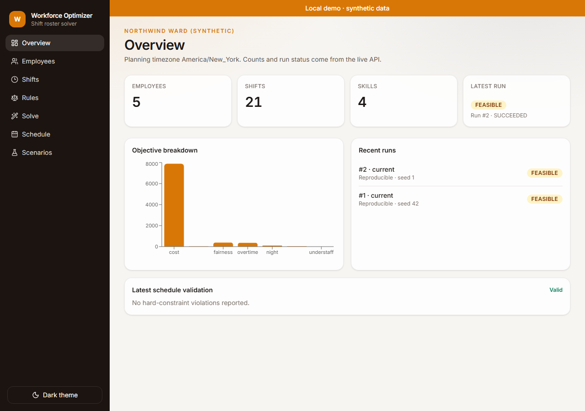
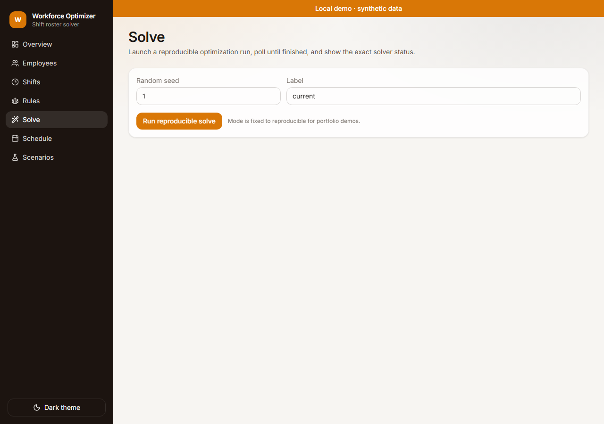

<a id="readme-top"></a>

<div align="center">

<picture>
  <source media="(prefers-color-scheme: dark)" srcset="docs/assets/banner-dark.svg">
  
</picture>

# Workforce Optimizer

**Constraint-based scheduling that explains every shift assignment.**

OR-Tools CP-SAT builds the roster. A pure-Python validator rechecks every hard constraint without importing the solver. Reproducible mode is first-class; infeasible demand stays `INFEASIBLE` — never a fake schedule. Accent `#D97706`.

[](https://github.com/hasanhuseyinyetkiner/workforce-optimizer/actions/workflows/ci.yml)

[Quick start](#quick-start) · [60-second demo](#60-second-demo) · [How it works](#how-it-works) · [Testing](#testing) · [Limitations](#security-privacy-and-limitations)

</div>

<p align="center">
  
</p>

## Why it exists

Staffing tools often hide the model or invent a roster when constraints conflict. This app keeps the CP-SAT parameters, solver status, and independent validation inspectable on a synthetic ward — so you can see *why* a shift was assigned, and when nothing legal exists.

## Features

| Area | Shipped |
| --- | --- |
| CP-SAT scheduler | Employee×shift booleans; coverage, skills, rest, PTO, weekly caps, consecutive days |
| Independent validator | Pure Python — no OR-Tools import; used by API validate + export paths |
| Solver modes | `reproducible` (`interleave_search`, seed, `max_deterministic_time`, ≤4 workers) · `fast` (wall-clock, labeled non-reproducible) |
| Honest status | `OPTIMAL` / `FEASIBLE` / `INFEASIBLE` / `UNKNOWN` — no fabricated assignments on infeasible |
| Demo scenarios | `feasible` and `infeasible` synthetic Northwind Ward seeds |
| Roster UI | Custom employee×day grid (MIT-safe; CI asserts no FullCalendar Premium) |
| Scenarios | Compare stored schedules: objective diffs + assignment diffs |
| Exports | CSV + ICS with validator summary |
| Ops | Loopback bind by default; solves off the event loop; stale `RUNNING` reaper |

## Quick start

Native path verified on Windows 11 with `uv` + `pnpm`. Docker Compose is exercised by the green `compose-smoke` CI job — not a substitute for the native path below.

```powershell
# Backend — http://127.0.0.1:8103
cd backend
uv sync
uv run python -m app.cli

# Frontend — http://127.0.0.1:5103 (new terminal)
cd frontend
pnpm install
pnpm dev
```

| Service | URL |
| --- | --- |
| Web | http://127.0.0.1:5103 |
| API docs | http://127.0.0.1:8103/docs |
| Health | http://127.0.0.1:8103/health |

Demo employees and shifts seed on startup. Copy [`.env.example`](.env.example) / [`frontend/.env.example`](frontend/.env.example) only for overrides. Non-loopback bind requires `ALLOW_NETWORK_BIND=true`.

## 60-second demo

### UI

1. Open http://127.0.0.1:5103 — banner **Local demo · synthetic data**.
2. **Solve** → **Run reproducible solve** (seed shown in the form).
3. Expect `FEASIBLE` or `OPTIMAL`, then **Schedule** — custom grid + **Validator summary: Valid**.
4. **Overview** → objective breakdown (cost / preference / fairness / …).
5. Optional: load the infeasible demo from the API (below), solve again → `INFEASIBLE`, no roster cells to export.

<p align="center">
  
</p>

### API (verified live on `:8103`, 2026-10-20)

**Feasible** — load → reproducible solve → validate:

```powershell
curl -X POST http://127.0.0.1:8103/api/demo/load -H "Content-Type: application/json" -d "{\"scenario\":\"feasible\"}"
curl -X POST http://127.0.0.1:8103/api/optimization-runs -H "Content-Type: application/json" -d "{\"mode\":\"reproducible\",\"random_seed\":42}"
# poll GET /api/optimization-runs/{id} until SUCCEEDED
curl -X POST http://127.0.0.1:8103/api/schedules/1/validate
```

Measured: `solver_status=FEASIBLE`, `objective=8788`, `schedule_id` present, validate → `{"valid":true,"violations":[]}`, 28 assignments on the latest schedule.

**INFEASIBLE** — same flow with `"scenario":"infeasible"`:

Measured: `solver_status=INFEASIBLE`, `schedule_id=null`, diagnostics include `no_qualified_employee` (Procedure needs CRNA; zero eligible). No schedule row is stored.

Playwright covers the happy path: `demo → solve → validate → export` (`frontend/e2e/demo-solve.spec.ts`).

## How it works


1. Build assignment variables and hard constraints in OR-Tools CP-SAT.
2. Soft weights minimize cost, preference mismatch, fairness deviation, overtime, night/weekend imbalance (understaff only when `relaxed_understaffing` is on).
3. Persist every solver parameter on `OptimizationRun`.
4. Recheck the assignment list with `app/domain/validator.py` before trusting validate/export.

Hard/soft rules and mode parameters: [docs/ALGORITHM.md](docs/ALGORITHM.md). Services: [docs/ARCHITECTURE.md](docs/ARCHITECTURE.md).

<p align="center">
  
</p>

## API

```powershell
curl http://127.0.0.1:8103/ready
curl -X POST http://127.0.0.1:8103/api/demo/load -H "Content-Type: application/json" -d "{\"scenario\":\"feasible\"}"
curl -X POST http://127.0.0.1:8103/api/optimization-runs -H "Content-Type: application/json" -d "{\"mode\":\"reproducible\",\"random_seed\":42}"
curl http://127.0.0.1:8103/api/schedules/latest
curl -X POST http://127.0.0.1:8103/api/schedules/1/validate
curl "http://127.0.0.1:8103/api/schedules/compare?left_id=1&right_id=2"
```

Key routes: `/api/employees`, `/api/shifts`, `/api/rulesets`, `/api/optimization-runs`, `/api/schedules/*`, `/api/schedules/{id}/export.csv`, `/api/schedules/{id}/export.ics`, `/health`, `/ready`.

## Testing

```powershell
cd backend
uv run ruff check app tests
uv run pytest -q

cd ../frontend
pnpm lint
pnpm typecheck
pnpm test
pnpm build
pnpm assert:no-fc-premium
pnpm exec playwright install chromium   # once
pnpm test:e2e
```

| Check | Result (re-verified 2026-10-20) |
| --- | --- |
| `uv run pytest -q` | **23 passed**, 1 skipped (Postgres marker) |
| `pnpm test` (Vitest) | **1 passed** |
| `pnpm test:e2e` | **1 passed** (demo→solve→validate→export) |
| Live API feasible → validate | `FEASIBLE` · `valid:true` · objective `8788` |
| Live API infeasible | `INFEASIBLE` · no schedule |
| `pnpm assert:no-fc-premium` | pass |

CI (`.github/workflows/ci.yml`): backend Ruff + pytest (PostgreSQL service), frontend lint / `tsc` / Vitest / build / FullCalendar guard, Playwright e2e, `compose-smoke`.

## Security, privacy and limitations

> [!IMPORTANT]
> Not labor-law compliance. Synthetic aliases only. Loopback by default (`127.0.0.1`). Solves run off the event loop with CP-SAT worker cap **4**. No multi-user auth in this MVP.

- Progressive relaxations on infeasible runs are **best-effort diagnostics**, not a proven minimal unsatisfiable core.
- `fast` mode is intentionally non-reproducible; demos and tests use `reproducible`.
- Timeouts are not optimality proofs (`UNKNOWN` ≠ “optimal enough”).

License: pending owner decision.

Docs: [ALGORITHM.md](docs/ALGORITHM.md) · [ARCHITECTURE.md](docs/ARCHITECTURE.md) · [GITHUB_METADATA.md](docs/GITHUB_METADATA.md) · [REVIEW_AMENDMENTS.md](docs/REVIEW_AMENDMENTS.md)

<p align="right"><a href="#readme-top">↑ back to top</a></p>
