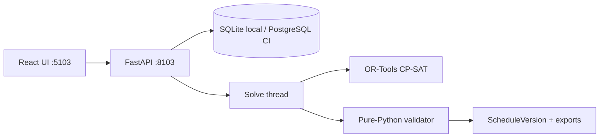

# Architecture

Workforce Optimizer is a local demo stack: a React SPA talks to a FastAPI service that persists planning state and runs OR-Tools CP-SAT off the request thread.

## Topology

| Service | Port | Role |
| --- | --- | --- |
| Web (Vite / nginx in Compose) | `127.0.0.1:5103` | Product UI |
| API (Uvicorn) | `127.0.0.1:8103` | REST + OpenAPI |
| PostgreSQL (Compose / CI only) | `127.0.0.1:5403` | Shared DB in Docker path |

Native development defaults to SQLite at `backend/data/workforce.db`. Compose and GitHub Actions use PostgreSQL; the same SQLAlchemy models apply.

## Layout

| Path | Role |
| --- | --- |
| `backend/app/domain/` | Problem DTOs, eligibility, CP-SAT model, validator, scoring, diagnostics |
| `backend/app/services/` | Seed, problem builder, run orchestration, serialization |
| `backend/app/api/` | HTTP routes |
| `backend/app/models.py` | SQLAlchemy entities (`OptimizationRun`, `ScheduleVersion`, …) |
| `frontend/src/pages/` | Overview, employees, shifts, rules, solve, **custom roster grid**, scenarios |
| `frontend/README.md` | Frontend scripts and roster notes |
| `compose.yaml` | Optional Docker path verified in CI (`compose-smoke`) only |

## Data flow

1. Demo seed or CRUD populates employees, skills, shifts, and an active ruleset.
2. `POST /api/optimization-runs` queues a run; a worker thread builds a `Problem`, applies `SolverConfig`, and calls `solve_problem`.
3. On `OPTIMAL` / `FEASIBLE`, assignments are stored as a `ScheduleVersion` with objective breakdown and an immediate validator pass.
4. On `INFEASIBLE` / `UNKNOWN`, diagnostics may be attached; **no assignment roster** is written for infeasible. (`MODEL_INVALID` from CP-SAT is mapped to `UNKNOWN` with an error string.)
5. UI polls the run, then loads `/api/schedules/latest` or compare/export endpoints.

## Failure handling

| Mechanism | Behavior |
| --- | --- |
| Loopback bind | Refuse non-loopback `HOST` unless `ALLOW_NETWORK_BIND=true` |
| Stale run reaper | Startup marks abandoned `RUNNING` rows `FAILED` |
| Worker cap | CP-SAT `num_workers` ≤ 4 |
| DST ingest | Nonexistent / ambiguous local walls rejected (`WFO-3`) |
| Validator gate | Export and validate use pure-Python hard checks |

## Security and privacy boundaries

- Default bind is loopback; CORS defaults to the Vite origin on `:5103`.
- No authentication in the MVP — suitable only for synthetic / already-authorized local demos.
- Demo banner (`APP_ENV=demo`) labels synthetic data in the UI.
- Not labor-law compliance software; hard rules are configurable model constraints only.

## Roster UI

The Schedule page renders a **custom employee×day grid** (`frontend/src/pages/SchedulePage.tsx`) — CSS grid with sticky employee column and per-day assignment chips. That is the shipped calendar surface.

CI runs `pnpm assert:no-fc-premium` so banned Premium calendar package strings cannot enter the lockfile (defensive licensing hygiene from historical WFO-2). See [ENGINEERING_DECISIONS.md](ENGINEERING_DECISIONS.md).

## Related docs

- [ALGORITHM.md](ALGORITHM.md) — CP-SAT formulation and status semantics
- [BENCHMARK.md](BENCHMARK.md) — measured micro-benchmark table
- [ENGINEERING_DECISIONS.md](ENGINEERING_DECISIONS.md) — WFO decisions + case study
- [REVIEW_AMENDMENTS.md](REVIEW_AMENDMENTS.md) — binding design-review overrides
- [RELEASE_READINESS.md](RELEASE_READINESS.md) — pre-publish checklist
- [../frontend/README.md](../frontend/README.md) — frontend developer notes
