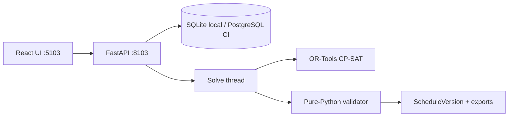

# Architecture

## Layout

| Path | Role |
| --- | --- |
| `backend/app/domain/` | Problem DTOs, eligibility, CP-SAT model, validator, scoring, diagnostics |
| `backend/app/services/` | Seed, problem builder, run orchestration, serialization |
| `backend/app/api/` | HTTP routes |
| `frontend/src/pages/` | Overview, employees, shifts, rules, solve, custom roster, scenarios |
| `compose.yaml` | Optional Docker path verified in CI only |

## Runtime notes

- Uvicorn binds `127.0.0.1` by default; non-loopback requires `ALLOW_NETWORK_BIND=true`.
- Solves run off the event loop in a worker thread; stale `RUNNING` rows are reaped at startup.
- Datetimes persist through `UtcDateTime` (WFO-3). DST gaps/overlaps are rejected at ingest.
- Roster UI is a custom employee×day grid (MIT-safe; no FullCalendar Premium).
